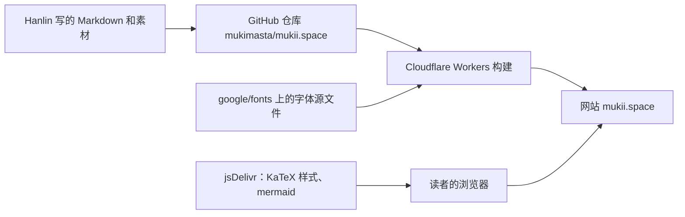
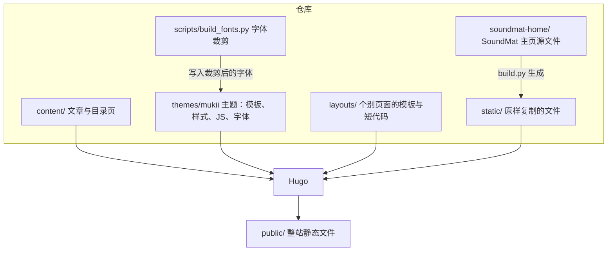
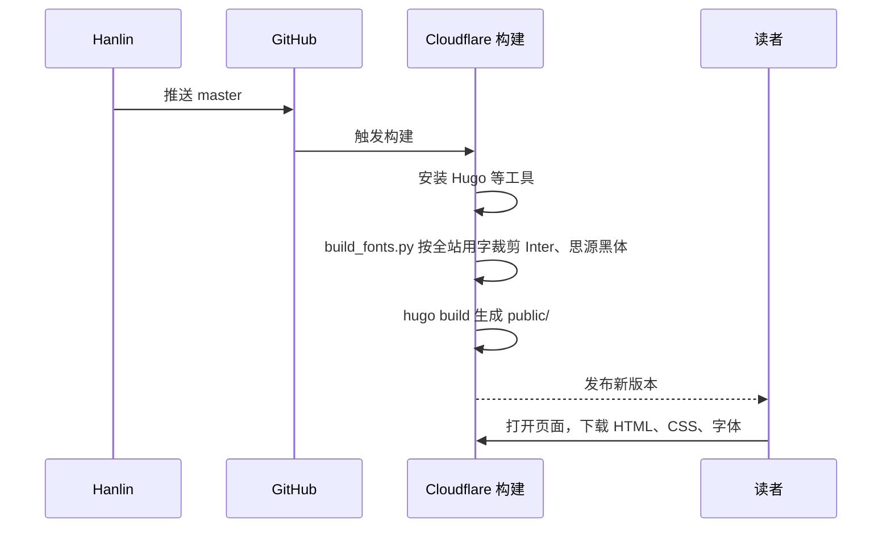

# Architecture

### 整体架构



仓库是唯一的源头。推到 `master` 后，Cloudflare 跑 `build.sh`，把整站生成成静态文件发布。公式的样式和 mermaid 图表在读者浏览器里从 jsDelivr 加载。

### 仓库里的几部分



Hugo 把 `content/` 的 Markdown 套进主题的模板；`layouts/` 里的模板优先于主题，只放个别页面专用的东西。SoundMat 主页不经过 Hugo 的模板：它的源文件在 `soundmat-home/`，手动运行 `build.py` 生成到 `static/soundmat/`，Hugo 原样复制。

### Runtime



### 架构树

1. 网站 mukii.space
    1. 首页：`content/_index.md` 的内容
    2. 目录页：各级 `_index.md`，文章列表是手写的链接
    3. 文章页：技术文章、《青叶树》、在西雅图的写作、SoundMat 文档
    4. 专页：Professional、Journey，各有自己的模板和样式
    5. SoundMat 主页：独立单页，中英两版，另有冻结的 GYDC 快照
2. 主题 themes/mukii
    1. 模板：页面骨架、页头、页脚、返回上一级、分享预览图
    2. 样式：`assets/css/default.css`，规则见 `design/VISUAL_DESIGN.md`
    3. 脚本：深色模式切换、脚注弹出
    4. 字体：Inter 和思源黑体的裁剪版
3. 构建与发布
    1. `build.sh`：Cloudflare 上的构建步骤
    2. `scripts/build_fonts.py`：字体裁剪
    3. `wrangler.toml`：Cloudflare Workers 配置

### 文件结构

```text
mukimasta/
├── README.md
├── AGENTS.md
├── MUKIDOC_PROTOCOL.md
├── hugo.toml                 网站配置（标题、主题、页脚名字）
├── build.sh                  Cloudflare 构建脚本
├── wrangler.toml
├── content/                  文章与目录页
├── layouts/                  个别页面的模板、短代码、公式与 mermaid 渲染
├── static/                   图片、SoundMat 主页生成结果、LifeLab 页面
├── themes/mukii/             网站主题
│   ├── layouts/
│   ├── assets/css/default.css
│   ├── assets/js/
│   └── static/fonts/
├── scripts/build_fonts.py
├── soundmat-home/            SoundMat 主页源文件
└── mukidoc/                  项目文档
```
